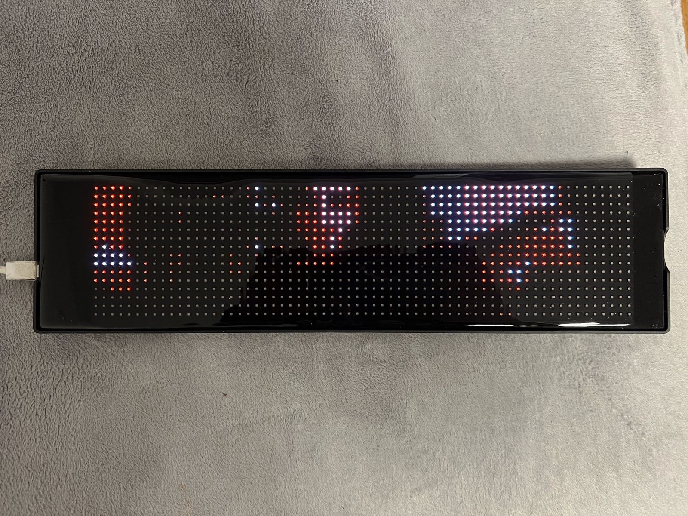
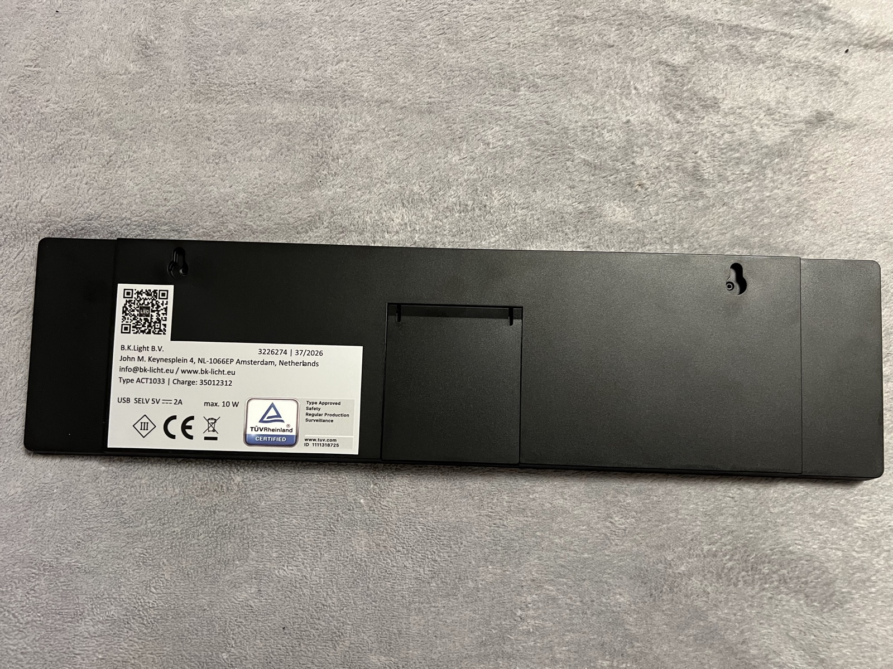
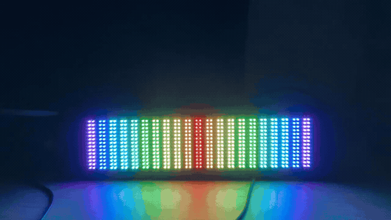
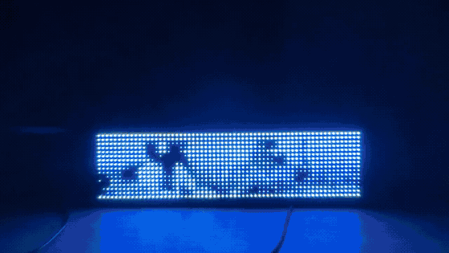
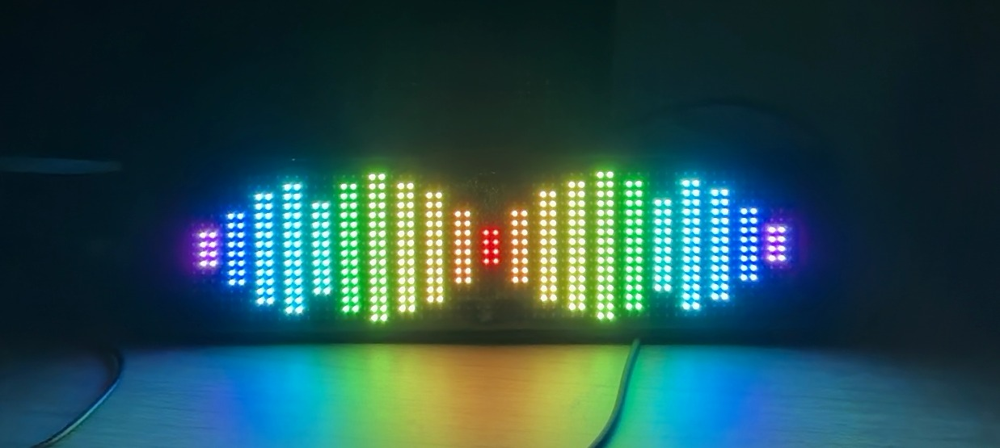
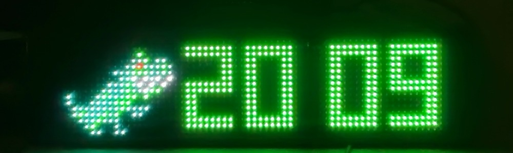
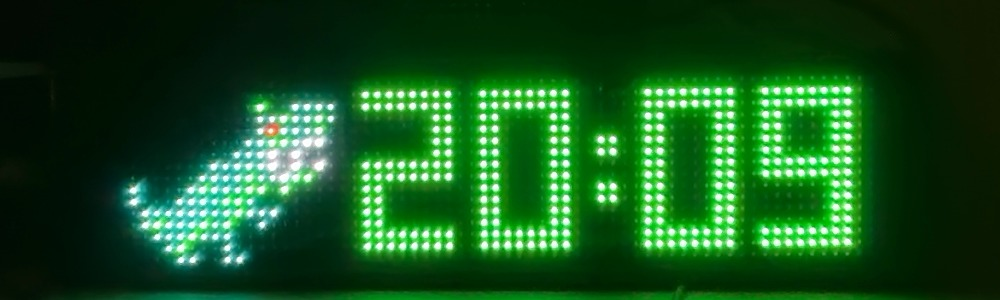
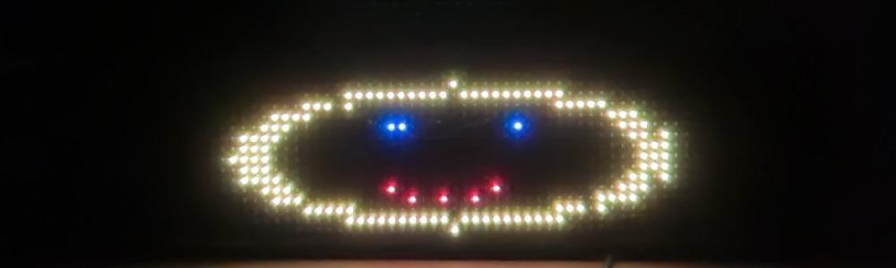
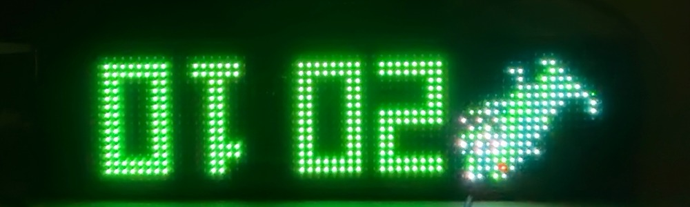

# ble-led-panel

Measurements and tools for a 64x16 Bluetooth LED panel.

The panel is sold by Action as "LED flexible fun screen" (B.K.Light ACT1033,
item 3226274). It is an iPixel Color device and works with
[pypixelcolor](https://github.com/lucagoc/pypixelcolor).




```
lib/bleclient.py   BLE transport: write-without-response, ACK per window; works on BlueZ 5.50
tools/             probes and benchmarks
led.sh             wrapper around the pypixelcolor CLI
docs/              photos and clips
```

## In use

Rhythm mode:



Video playback at 12 fps over BLE:



| | |
|---|---|
|  |  |
| text mode | rhythm mode |
|  |  |
| native clock | native timer |
|  |  |
| DIY mode | orientation flipped |

## Device

| | |
|---|---|
| Label | B.K.Light ACT1033, 96x369 mm, USB-C 5 V / 2 A, BLE only |
| BLE name | `LED_BLE_` + the last four bytes of the MAC |
| Device type | 131 (0x83) |
| Resolution | 64x16 (lookup by device type; the device-info response carries no dimensions) |
| GATT | `0x00FA`: `FA02` write / write-without-response, `FA03` notify. `0xAE00`: JieLi RCSP (`AE01` write-without-response, `AE02` notify) |
| Connections | one BLE client at a time |

## Measurements

One unit, driven from a MacBook (CoreBluetooth) and a Raspberry Pi 4 (BlueZ 5.50).
Frame rates were counted with a 30 fps camera pointed at the panel and checked by
eye above 15 fps.

**Transport.** pypixelcolor writes every 244-byte chunk with response, about 13 round
trips per 3 KB frame: 3.2 fps and about 3 KB/s from macOS. `FA02` accepts
write-without-response and the firmware acknowledges per 12 KB window.
`lib/bleclient.py` writes chunks without response and waits only for the window
ACK: camera streaming went from 2.9 to 9.5 fps, 11.9 fps with 16 colours. From the
Pi a 15 KB upload takes 2.3 s either way. Throughput measured from macOS without
waiting for ACKs is not meaningful; CoreBluetooth queues writes without backpressure.

**Repaint rate.** Rhythm-mode toggles between full and empty bars: 100 % visible at
15 per second, 97 % at 20. The panel repaints at 20 Hz or more.

**Full frames.** 64x16 PNG frames of about 150 bytes:

| mode | result |
|---|---|
| wait for window ACK | 16 fps, self-paced |
| fire-and-forget | 20 fps clean; smooth to 21 fps by eye, stutter from 22 |

Above the ceiling the panel shows partly decoded frames instead of dropping them.

**Video.** Decode time grows with frame size, roughly `37 ms + 0.10 ms/byte`:

| frame | PNG | fps (ACK-paced) |
|---|---|---|
| synthetic, 4 colours | 150 B | 21.0 |
| film, 4 colours | 256 B | 14.2 |
| film, 16 colours | 444 B | 11.9 |
| camera, 16 colours | 490 B | 11.9 |

**GIF playback from flash.**

| GIF | frames | result |
|---|---|---|
| 8 KB | 35 | smooth |
| 26 KB | 72 | smooth |
| 44 KB | 117 | stutters |
| 7 KB, 110 ms/frame | 12 | clean |
| 14 KB, 60 ms/frame | 24 | stutters |

**Modes.**

- DIY (`0x0104` + `set_pixel 0x0105`): no flow control; pixels are lost above about
  100 per second; several PDUs in one write are not honoured.
- Rhythm: `10 00 01 02 <style 0-4> <11 bar heights 0-15>`, a mirrored 11-band
  equaliser in five styles.
- Clock (`0x0106`, styles 0-7), orientation (`0x8006`), timer (`0x8009`): work.
  Scores (`0x800a`): no effect on this unit.
- RCSP (`0xAE00`) answers only after the authentication described by Quarkslab
  (linked below).

## Raspberry Pi

bleak 2.x fails on BlueZ 5.50 (`KeyError: 'Roles'`), bleak 1.x refuses BlueZ below
5.55 and loses notifications when the subscription is restarted per command.
`lib/bleclient.py` keeps one notify subscription open, bypasses the version gate and
reuses pypixelcolor's command builders. `hciconfig hci0 reset` before connecting
clears a stale link left by an abrupt disconnect.

## Tools

Run from the repository root with `LED_ADDR` set (`./led.sh scan` prints it).

| script | |
|---|---|
| `rate_probe.py` | repaint rate via rhythm-mode toggles |
| `frame_probe.py` | full-frame ceiling, fire-and-forget |
| `smooth_test.py` | constant-speed animation at increasing fps |
| `video_play.py` | video file playback, ACK-paced |
| `cam_stream_fast.py` | live camera to panel |
| `rhythm_viz.py`, `music_av.py` | audio FFT to rhythm mode |
| `diy_rate.py` | `set_pixel` throughput |
| `modes_tour.py` | photograph the native modes |
| `probe_devinfo.py`, `rcsp_probe.py` | GATT inventory, device info, RCSP probe |
| `link_bench.py` | raw link throughput (not valid from macOS, see above) |

## Credits

- [lucagoc/pypixelcolor](https://github.com/lucagoc/pypixelcolor) (MIT), used
  throughout; this repository reuses its command builders.
- [hbldh/bleak](https://github.com/hbldh/bleak) (MIT).
- Quarkslab, [A modern tale of blinkenlights](https://blog.quarkslab.com/modern-tale-blinkenlights.html):
  JieLi RCSP authentication.

## Licence

Code GPL-3.0-or-later, photos and clips CC BY-SA 4.0. Artur Andrzejczak, with help
from Claude.
